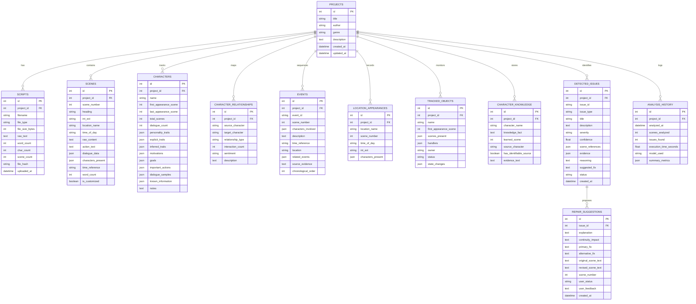

# PlotHole OS – Database Schema & Data Model Specification

## 1. Overview & Architectural Philosophy

PlotHole OS uses an embedded relational persistence model powered by **SQLite** and **SQLAlchemy ORM** (version 2.0+). The data layer bridges:
1. **Relational Database Entities (`database/models.py`)**: Persistent SQLite tables representing scripts, scenes, characters, narrative events, tracked entities, continuity plot holes, and AI repairs.
2. **Pydantic Validation Schemas (`core/schemas.py`)**: Subscriptable data transfer objects (DTOs) used across API interfaces, AI structured generation, and JSON export pipelines.
3. **Dual-Access Interoperability (`ModelAccessMixin` & `SubscriptableSchema`)**: Both ORM models and Pydantic schemas implement dictionary subscripting (`obj["field"]`), safe access (`obj.get("field")`), and standard attribute access (`obj.field`), preventing `TypeError: object is not subscriptable` errors.

---

## 2. Entity-Relationship Diagram (ERD)

---

## 3. Table Specifications

### 3.1 `projects`
Represents the screenplay or narrative workspace.

| Column | Type | Constraints | Description |
| :--- | :--- | :--- | :--- |
| `id` | INTEGER | PRIMARY KEY, AUTOINCREMENT | Unique project identifier |
| `title` | VARCHAR(255) | NOT NULL | Title of the screenplay |
| `author` | VARCHAR(255) | DEFAULT 'Unknown' | Screenwriter / Author name |
| `genre` | VARCHAR(100) | DEFAULT 'General' | Genre (e.g. Sci-Fi, Thriller) |
| `description` | TEXT | NULLABLE | Logline or narrative summary |
| `created_at` | DATETIME | DEFAULT UTC now | Creation timestamp |
| `updated_at` | DATETIME | DEFAULT UTC now | Last modification timestamp |

### 3.2 `scripts`
Stores raw uploaded text and file metadata.

| Column | Type | Constraints | Description |
| :--- | :--- | :--- | :--- |
| `id` | INTEGER | PRIMARY KEY, AUTOINCREMENT | Script record ID |
| `project_id` | INTEGER | FOREIGN KEY -> `projects.id` | Associated project |
| `filename` | VARCHAR(255) | NOT NULL | Original upload filename |
| `file_type` | VARCHAR(50) | NOT NULL | PDF, TXT, DOCX |
| `file_size_bytes` | INTEGER | NOT NULL | Raw byte size |
| `raw_text` | TEXT | NOT NULL | Extracted text content |
| `word_count` | INTEGER | DEFAULT 0 | Extracted word count |
| `char_count` | INTEGER | DEFAULT 0 | Extracted character count |
| `scene_count` | INTEGER | DEFAULT 0 | Number of segmented scenes |
| `file_hash` | VARCHAR(64) | NULLABLE | SHA-256 content checksum |
| `uploaded_at` | DATETIME | DEFAULT UTC now | Ingestion timestamp |

### 3.3 `scenes`
Represents parsed narrative units / screenplay scenes.

| Column | Type | Constraints | Description |
| :--- | :--- | :--- | :--- |
| `id` | INTEGER | PRIMARY KEY, AUTOINCREMENT | Scene internal ID |
| `project_id` | INTEGER | FOREIGN KEY -> `projects.id` | Associated project |
| `scene_number` | INTEGER | NOT NULL | Sequential scene index (1-based) |
| `heading` | VARCHAR(255) | NOT NULL | Raw scene heading / slugline |
| `int_ext` | VARCHAR(50) | DEFAULT 'INT' | Interior, Exterior, or INT/EXT |
| `location_name` | VARCHAR(255) | NOT NULL | Normalized location name |
| `time_of_day` | VARCHAR(100) | DEFAULT 'DAY' | DAY, NIGHT, DUSK, DAWN, etc. |
| `raw_content` | TEXT | NOT NULL | Full unedited text of the scene |
| `action_text` | TEXT | DEFAULT '' | Description/action paragraphs |
| `dialogue_data` | JSON | DEFAULT '[]' | List of `{character, text, parenthetical}` |
| `characters_present` | JSON | DEFAULT '[]' | List of character names present |
| `time_reference` | VARCHAR(255) | NULLABLE | Explicit time cues (e.g. '10:00 PM') |
| `word_count` | INTEGER | DEFAULT 0 | Word count of the scene |
| `is_customized` | BOOLEAN | DEFAULT FALSE | Flag indicating manual user correction |

### 3.4 `characters`
Structured dossiers for identified characters.

| Column | Type | Constraints | Description |
| :--- | :--- | :--- | :--- |
| `id` | INTEGER | PRIMARY KEY, AUTOINCREMENT | Character record ID |
| `project_id` | INTEGER | FOREIGN KEY -> `projects.id` | Associated project |
| `name` | VARCHAR(255) | NOT NULL | Uppercase normalized character name |
| `first_appearance_scene` | INTEGER | NULLABLE | Earliest scene number |
| `last_appearance_scene` | INTEGER | NULLABLE | Latest scene number |
| `total_scenes` | INTEGER | DEFAULT 0 | Total scene count where present |
| `dialogue_count` | INTEGER | DEFAULT 0 | Total spoken lines |
| `personality_traits` | JSON | DEFAULT '[]' | List of descriptive traits |
| `explicit_traits` | JSON | DEFAULT '[]' | Script-stated traits |
| `inferred_traits` | JSON | DEFAULT '[]' | AI/NLP-inferred behavioral traits |
| `motivations` | JSON | DEFAULT '[]' | Identified goals and drives |
| `goals` | JSON | DEFAULT '[]' | Specific objective statements |
| `important_actions` | JSON | DEFAULT '[]' | Key narrative actions performed |
| `dialogue_samples` | JSON | DEFAULT '[]' | Representative dialogue excerpts |
| `known_information` | JSON | DEFAULT '[]' | List of established known facts |
| `notes` | TEXT | NULLABLE | Analyst/writer notes |

### 3.5 `character_relationships`
Interaction and co-occurrence graph edges.

| Column | Type | Constraints | Description |
| :--- | :--- | :--- | :--- |
| `id` | INTEGER | PRIMARY KEY, AUTOINCREMENT | Relationship record ID |
| `project_id` | INTEGER | FOREIGN KEY -> `projects.id` | Associated project |
| `source_character` | VARCHAR(255) | NOT NULL | First character in pair |
| `target_character` | VARCHAR(255) | NOT NULL | Second character in pair |
| `relationship_type` | VARCHAR(100) | DEFAULT 'Acquaintance' | Relationship classification |
| `interaction_count` | INTEGER | DEFAULT 1 | Co-occurrences + dialogue exchanges |
| `sentiment` | VARCHAR(50) | DEFAULT 'Neutral' | Positive, Negative, Neutral |
| `description` | TEXT | NULLABLE | Contextual description |

### 3.6 `events`
Chronological narrative occurrences extracted from action and dialogue.

| Column | Type | Constraints | Description |
| :--- | :--- | :--- | :--- |
| `id` | INTEGER | PRIMARY KEY, AUTOINCREMENT | Event record ID |
| `project_id` | INTEGER | FOREIGN KEY -> `projects.id` | Associated project |
| `event_id` | VARCHAR(50) | NOT NULL | Unique code (e.g. 'EV001') |
| `scene_number` | INTEGER | NOT NULL | Scene where event occurred |
| `characters_involved` | JSON | DEFAULT '[]' | Participating characters |
| `description` | TEXT | NOT NULL | Concise factual description |
| `time_reference` | VARCHAR(255) | NULLABLE | Explicit clock/time cue |
| `location` | VARCHAR(255) | NULLABLE | Location where event took place |
| `related_events` | JSON | DEFAULT '[]' | Causal or chronological links |
| `source_evidence` | TEXT | NULLABLE | Verbatim line from script |
| `chronological_order` | INTEGER | DEFAULT 0 | Estimated true sequence index |

### 3.7 `tracked_objects`
Prop and physical object continuity registry.

| Column | Type | Constraints | Description |
| :--- | :--- | :--- | :--- |
| `id` | INTEGER | PRIMARY KEY, AUTOINCREMENT | Object record ID |
| `project_id` | INTEGER | FOREIGN KEY -> `projects.id` | Associated project |
| `name` | VARCHAR(255) | NOT NULL | Object name (e.g. 'Flash Drive') |
| `first_appearance_scene`| INTEGER | NULLABLE | Scene introduced |
| `scenes_present` | JSON | DEFAULT '[]' | List of scenes object appears in |
| `handlers` | JSON | DEFAULT '[]' | Characters who carried/used object |
| `owner` | VARCHAR(255) | NULLABLE | Current possessing character |
| `status` | VARCHAR(100) | DEFAULT 'Intact' | Physical state (Intact, Destroyed, Lost) |
| `state_changes` | JSON | DEFAULT '[]' | History of changes |

### 3.8 `character_knowledge_entries`
Tracks epistemic state: who knows what and when.

| Column | Type | Constraints | Description |
| :--- | :--- | :--- | :--- |
| `id` | INTEGER | PRIMARY KEY, AUTOINCREMENT | Record ID |
| `project_id` | INTEGER | FOREIGN KEY -> `projects.id` | Associated project |
| `character_name` | VARCHAR(255) | NOT NULL | Recipient / knowing character |
| `knowledge_fact` | TEXT | NOT NULL | Fact or confidential secret |
| `learned_scene` | INTEGER | NOT NULL | Scene where character learned fact |
| `source_character` | VARCHAR(255) | NULLABLE | Revealer / discloser |
| `has_identifiable_source`| BOOLEAN | DEFAULT TRUE | Whether source is explicitly shown |
| `evidence_text` | TEXT | NULLABLE | Verbatim text evidence |

### 3.9 `detected_issues`
Continuity plot holes and logical breaches discovered by rule detectors or AI.

| Column | Type | Constraints | Description |
| :--- | :--- | :--- | :--- |
| `id` | INTEGER | PRIMARY KEY, AUTOINCREMENT | Issue record ID |
| `project_id` | INTEGER | FOREIGN KEY -> `projects.id` | Associated project |
| `issue_id` | VARCHAR(50) | NOT NULL | Issue code (e.g. 'TL001', 'KN002') |
| `issue_type` | VARCHAR(100) | NOT NULL | Category (e.g. Timeline, Knowledge) |
| `title` | VARCHAR(255) | NOT NULL | Short issue headline |
| `description` | TEXT | NOT NULL | Comprehensive narrative breakdown |
| `severity` | VARCHAR(50) | DEFAULT 'Medium' | Critical, High, Medium, Low, Info |
| `confidence` | FLOAT | DEFAULT 0.85 | Algorithmic confidence (0.0 to 1.0) |
| `scene_references` | JSON | DEFAULT '[]' | Associated scene numbers |
| `evidence` | JSON | DEFAULT '[]' | List of `{scene_number, text}` |
| `reasoning` | TEXT | NULLABLE | Causal deduction chain |
| `suggested_fix` | TEXT | NULLABLE | Actionable narrative solution |
| `status` | VARCHAR(50) | DEFAULT 'Open' | Open, In Review, Resolved, Dismissed |
| `created_at` | DATETIME | DEFAULT UTC now | Creation timestamp |

### 3.10 `repair_suggestions`
AI-synthesized narrative solutions with line-by-line diffs.

| Column | Type | Constraints | Description |
| :--- | :--- | :--- | :--- |
| `id` | INTEGER | PRIMARY KEY, AUTOINCREMENT | Suggestion record ID |
| `issue_id` | INTEGER | FOREIGN KEY -> `detected_issues.id` | Associated issue |
| `explanation` | TEXT | NOT NULL | Explanation of the continuity repair |
| `continuity_impact`| TEXT | NULLABLE | Downstream impact on other scenes |
| `primary_fix` | TEXT | NOT NULL | Best narrative rewrite recommendation |
| `alternative_fix` | TEXT | NULLABLE | Secondary compromise solution |
| `original_scene_text`| TEXT | NULLABLE | Verbatim target scene text |
| `revised_scene_text`| TEXT | NULLABLE | Rewritten scene text |
| `scene_number` | INTEGER | DEFAULT 1 | Target scene number |
| `user_status` | VARCHAR(50) | DEFAULT 'Pending' | Pending, Accepted, Rejected, Saved |
| `user_feedback` | TEXT | NULLABLE | Writer feedback or notes |
| `created_at` | DATETIME | DEFAULT UTC now | Creation timestamp |

### 3.11 `analysis_history`
Audit and benchmark logs for each analysis execution.

| Column | Type | Constraints | Description |
| :--- | :--- | :--- | :--- |
| `id` | INTEGER | PRIMARY KEY, AUTOINCREMENT | History log ID |
| `project_id` | INTEGER | FOREIGN KEY -> `projects.id` | Associated project |
| `analyzed_at` | DATETIME | DEFAULT UTC now | Execution timestamp |
| `scenes_analyzed` | INTEGER | DEFAULT 0 | Total scenes processed |
| `issues_found` | INTEGER | DEFAULT 0 | Issues identified |
| `execution_time_seconds`| FLOAT | DEFAULT 0.0 | Runtime duration |
| `model_used` | VARCHAR(100) | DEFAULT 'Rule-Based Engine'| AI model or hybrid |
| `summary_metrics`| JSON | DEFAULT '{}' | Snapshot of metrics |

---

## 4. Indexing & Query Optimization Strategy

To ensure sub-second response times on screenplays up to 200 scenes:
1. `CREATE INDEX idx_scenes_proj_num ON scenes(project_id, scene_number);`
2. `CREATE INDEX idx_issues_proj_sev ON detected_issues(project_id, severity);`
3. `CREATE INDEX idx_chars_proj_name ON characters(project_id, name);`
4. `CREATE INDEX idx_events_proj_order ON events(project_id, chronological_order);`
5. `CREATE INDEX idx_relationships_proj ON character_relationships(project_id, source_character, target_character);`

---

## 5. Dual-Access Compatibility Contract

To avoid any `TypeError: object is not subscriptable` or `AttributeError` exceptions:
- **Rule 1**: All database queries must use `expire_on_commit=False` to prevent `DetachedInstanceError`.
- **Rule 2**: All ORM models inherit `ModelAccessMixin`, allowing both `obj["field"]` and `obj.field`.
- **Rule 3**: All Pydantic models inherit `SubscriptableSchema`, allowing both `model["field"]` and `model.field`.
- **Rule 4**: Cross-boundary data passing must utilize `get_val(obj, "field", default)` for complete decoupling.

