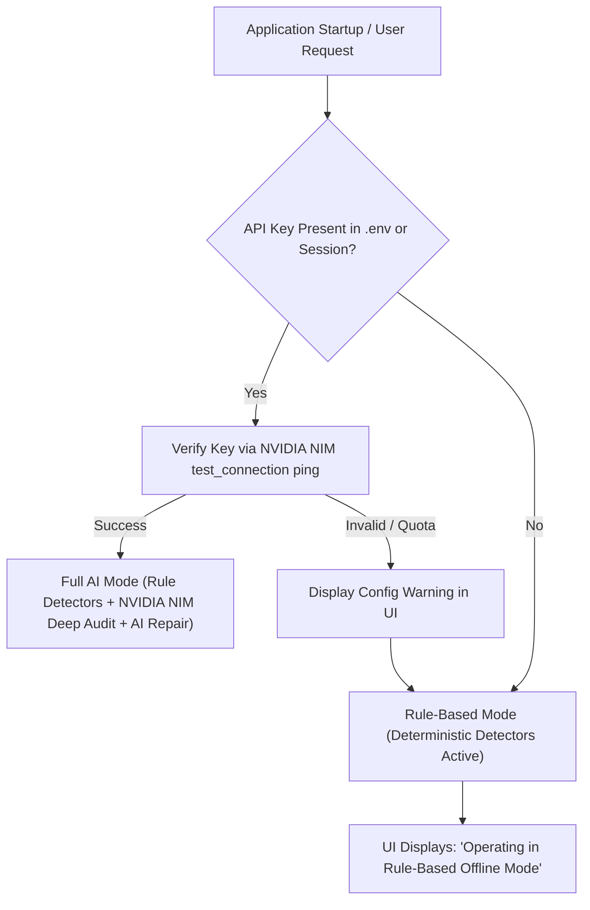

# PlotHole OS – Master Implementation Plan

> **Tagline:** *"Every Story Has a Logic. We Find Where It Breaks."*  
> **System Role:** Senior Software Architect, AI/ML Engineer, and Technical Project Manager.  
> **Target Scope:** Strictly script-based screenplay & story analysis (PDF, DOCX, TXT). No video or audio processing.

---

## 1. Executive Summary & Project Status

**PlotHole OS** is an intelligent, script-based screenplay analysis and continuity debugging platform. It ingests narrative text, extracts structural units (scenes, characters, locations, events, timelines, knowledge states, and physical objects), and runs an 8-detector continuity debugging engine combined with NVIDIA NIM contextual reasoning.

### High-Level Status:
- **Baseline Architecture:** Fully designed, implemented, and verified.
- **Codebase Health:** Clean compilation across all modules (`python -m compileall .` exit code 0).
- **Test Coverage:** 16 automated tests in `tests/` passing with 100% success rate.
- **Subscripting Resilience:** Universal dual-access pattern implemented across SQLAlchemy models, Pydantic schemas, and dictionary helpers.

---

## 2. Comprehensive Codebase Audit

### 2.1 Completed & Verified Features
1. **Document Ingestion (`core/document_processor.py`)**: Multi-format parsing for PDF, DOCX, and TXT with file-size gating (30MB), UTF-8/Latin-1 encoding fallback, empty-file detection, and SHA-256 deduplication.
2. **Dual-Mode Script Parsing (`core/script_parser.py`)**:
   - Standard screenplay parser extracting scene numbers, interior/exterior environments, location names, day/night indicators, uppercase character cues, parentheticals, and action descriptions.
   - Prose narrative fallback for stories lacking formal sluglines.
   - Slugline merging for adjacent multi-line headers (e.g. `SCENE 1` + `INT. LAB - DAY`).
3. **Narrative Modeling Engines**:
   - `SceneExtractor`: Scene normalization and character presence assignment.
   - `CharacterExtractor`: Character dossiers, speaking frequencies, explicit traits, and co-occurrence graphs.
   - `EventExtractor`: Narrative event extraction and chronological ordering.
   - `TimelineEngine`: Explicit clock timestamps and relative temporal cue parsing.
   - `LocationTracker`: Unique story locations and character spatial journeys across scenes.
   - `KnowledgeTracker`: Confidential disclosures, secret ciphers, and witness presence mapping.
   - `ObjectTracker`: Prop state monitoring, physical status changes, and possession tracking.
4. **Continuity Detection Coordinator & 8 Specialized Detectors (`detection/`)**:
   - `TimelineContradictionDetector`: Backward time jumps and conflicting timestamps.
   - `CharacterConsistencyDetector`: Post-mortem actions and erratic personality shifts.
   - `LocationContinuityDetector`: Instantaneous travel between distant locations.
   - `KnowledgeLeakDetector`: Characters using secrets before being informed.
   - `ObjectContinuityDetector`: Using destroyed or missing props.
   - `MotivationContradictionDetector`: Unprompted betrayals and alliance shifts.
   - `MissingTransitionDetector`: Jarring scene transitions without narrative bridges.
   - `LogicalContradictionDetector`: Multi-location co-presence and causal paradoxes.
5. **AI Reasoning & Story Repair (`ai/`)**:
   - NVIDIA NIM API integration with `minimaxai/minimax-m3.1-flash` default model and OpenAI-compatible SDK.
   - Structured JSON prompt engineering.
   - AI Story Repair Assistant with primary recommendations, alternative solutions, and side-by-side narrative diffs (`added`, `deleted`, `equal`).
   - Graceful offline fallback when no API key is configured.
6. **Persistence & Data Model Layer (`database/`)**:
   - SQLite persistence via SQLAlchemy 2.0 with foreign keys and cascade rules.
   - `ModelAccessMixin` and `SubscriptableSchema` dual-access system.
7. **Interactive Dashboard & Visualizations (`app.py`, `visualization/`)**:
   - Streamlit 12-module navigation interface with custom dark theme CSS.
   - 7 Plotly/NetworkX visualizations (Timeline Scatter, Character Network, Appearance Frequency, Scene Narrative Density, Severity Donut, Continuity Health Gauge, Location Trajectories, Knowledge Disclosures).
8. **Reports & Exports (`reports/`)**:
   - Executive PDF generation via ReportLab with tables and evidence cards.
   - Structured JSON project export.

### 2.2 Repaired Architectural Issues & Legacy Bugs
- **Fixed `TypeError: 'Scene' object is not subscriptable`**: Added `ModelAccessMixin` (`__getitem__`, `__setitem__`, `__contains__`, `get()`) to SQLAlchemy models and created `get_val()` helper.
- **Fixed `DetachedInstanceError`**: Configured `expire_on_commit=False` in `sessionmaker`.
- **Fixed `NameError: Tuple`**: Added missing import in `core/script_parser.py`.
- **Fixed Pydantic v2 Deprecation**: Migrated `class Config` to `model_config = SettingsConfigDict(...)`.
- **Fixed JSON Serialization Bug**: Resolved recursion crash on nested dictionaries and lists in `reports/json_exporter.py`.
- **Eliminated Python 3.13 Datetime Deprecations**: Replaced `datetime.utcnow()` with `datetime.now(timezone.utc)` in database, PDF, and JSON exporters.

### 2.3 Remaining Enhancements & Planned Features
- **Alembic Database Migrations**: Formal migration versioning for future schema changes.
- **Fountain Specification Extensions**: Full parser support for centered transitions (`> CUT TO: <`) and boneyard comments (`/* ... */`).
- **Final Draft XML (FDX) Export**: Direct export into industry-standard `.fdx` format with embedded continuity review annotations.
- **Multi-Script Comparative Analysis**: Comparing different revisions (Draft 1 vs Draft 2) to track continuity regressions across rewrites.

---

## 3. Detailed Technical Specifications

### Module 1: Document Preprocessor & Validator
- **Files**: [core/document_processor.py](file:///c:/Users/moolc/OneDrive/Desktop/Generative%20ID/core/document_processor.py), [utils/validators.py](file:///c:/Users/moolc/OneDrive/Desktop/Generative%20ID/utils/validators.py), [utils/text_cleaner.py](file:///c:/Users/moolc/OneDrive/Desktop/Generative%20ID/utils/text_cleaner.py)
- **Inputs**: Raw uploaded file bytes, original filename.
- **Outputs**: Dictionary with extracted clean text, word count, character count, estimated scene count, and SHA-256 hash.
- **Dependencies**: `pypdf`, `python-docx`, `hashlib`.
- **Key Functions**: `validate_file_type()`, `validate_file_size()`, `extract_text()`, `clean_text()`.

### Module 2: Script & Scene Parsing Engine
- **Files**: [core/script_parser.py](file:///c:/Users/moolc/OneDrive/Desktop/Generative%20ID/core/script_parser.py), [core/scene_extractor.py](file:///c:/Users/moolc/OneDrive/Desktop/Generative%20ID/core/scene_extractor.py)
- **Inputs**: Normalized script text string.
- **Outputs**: List of typed `Scene` objects with heading, location, time cue, action text, dialogue blocks, and present characters.
- **Dependencies**: Regular expressions, standard string parsers.
- **Key Functions**: `parse_screenplay()`, `parse_prose()`, `extract_scene_metadata()`.

### Module 3: Character & Relationship Extractor
- **Files**: [core/character_extractor.py](file:///c:/Users/moolc/OneDrive/Desktop/Generative%20ID/core/character_extractor.py)
- **Inputs**: List of `Scene` objects.
- **Outputs**: List of `Character` objects (dossiers) and list of `CharacterRelationship` interaction edges.
- **Dependencies**: `collections.defaultdict`, `re`.
- **Key Functions**: `extract_characters()`, `compute_relationships()`.

### Module 4: Chronological Timeline & Narrative State Engines
- **Files**: [core/timeline_engine.py](file:///c:/Users/moolc/OneDrive/Desktop/Generative%20ID/core/timeline_engine.py), [core/event_extractor.py](file:///c:/Users/moolc/OneDrive/Desktop/Generative%20ID/core/event_extractor.py), [core/location_tracker.py](file:///c:/Users/moolc/OneDrive/Desktop/Generative%20ID/core/location_tracker.py), [core/knowledge_tracker.py](file:///c:/Users/moolc/OneDrive/Desktop/Generative%20ID/core/knowledge_tracker.py), [core/object_tracker.py](file:///c:/Users/moolc/OneDrive/Desktop/Generative%20ID/core/object_tracker.py)
- **Inputs**: Parsed scenes.
- **Outputs**: Structured chronological timelines, location tracking matrices, epistemic disclosure tables, and prop status registries.
- **Dependencies**: `datetime`, `re`.
- **Key Functions**: `track_locations()`, `track_knowledge()`, `track_objects()`, `extract_events()`.

### Module 5: Continuity Detection Coordinator & Detectors
- **Files**: [detection/detector_coordinator.py](file:///c:/Users/moolc/OneDrive/Desktop/Generative%20ID/detection/detector_coordinator.py) and 8 detector files in `detection/`.
- **Inputs**: Scenes, characters, events, locations, knowledge, and objects.
- **Outputs**: List of `DetectedIssue` objects with issue ID, category, title, description, severity, confidence, scene references, verbatim evidence, and suggested fix.
- **Dependencies**: Core engines, `utils/helpers.py`.
- **Key Functions**: `run_all_detectors()`, individual `detect()` methods per class.

### Module 6: NVIDIA NIM AI Reasoning & Story Repair
- **Files**: [ai/nvidia_service.py](file:///c:/Users/moolc/OneDrive/Desktop/Generative%20ID/ai/nvidia_service.py), [ai/gemini_service.py](file:///c:/Users/moolc/OneDrive/Desktop/Generative%20ID/ai/gemini_service.py), [ai/reasoning_engine.py](file:///c:/Users/moolc/OneDrive/Desktop/Generative%20ID/ai/reasoning_engine.py), [ai/repair_assistant.py](file:///c:/Users/moolc/OneDrive/Desktop/Generative%20ID/ai/repair_assistant.py), [ai/prompts.py](file:///c:/Users/moolc/OneDrive/Desktop/Generative%20ID/ai/prompts.py)
- **Inputs**: Scene texts, detected issues, screenwriter preferences.
- **Outputs**: Contextual issue validations, narrative rewrites, impact analysis, and diff blocks.
- **Dependencies**: `openai`, `difflib`.
- **Key Functions**: `generate_structured_json()`, `analyze_script_context()`, `generate_repair()`.

### Module 7: Visualization Engine
- **Files**: [visualization/timeline_chart.py](file:///c:/Users/moolc/OneDrive/Desktop/Generative%20ID/visualization/timeline_chart.py), [visualization/character_graph.py](file:///c:/Users/moolc/OneDrive/Desktop/Generative%20ID/visualization/character_graph.py), [visualization/analytics.py](file:///c:/Users/moolc/OneDrive/Desktop/Generative%20ID/visualization/analytics.py)
- **Inputs**: Scenes, characters, relationships, issues, knowledge data.
- **Outputs**: Plotly `go.Figure` instances styled in dark mode.
- **Dependencies**: `plotly`, `networkx`.
- **Key Functions**: `create_timeline_chart()`, `create_character_network_graph()`, `create_severity_donut()`, `create_issue_type_bar()`, `create_continuity_gauge()`, `create_character_appearance_chart()`, `create_scene_distribution_chart()`, `create_knowledge_map()`, `create_location_journey_chart()`.

### Module 8: Report Generation
- **Files**: [reports/pdf_generator.py](file:///c:/Users/moolc/OneDrive/Desktop/Generative%20ID/reports/pdf_generator.py), [reports/json_exporter.py](file:///c:/Users/moolc/OneDrive/Desktop/Generative%20ID/reports/json_exporter.py)
- **Inputs**: Complete project summary dictionary.
- **Outputs**: PDF byte stream, formatted JSON string.
- **Dependencies**: `reportlab`, `json`.
- **Key Functions**: `generate_pdf_report()`, `export_project_json()`.

---

## 4. API Key & Offline Fallback Management Plan

The system enforces strict API key isolation and graceful offline operation:

### Key Security & Operational Guarantees:
1. **Never Hardcoded**: Keys are loaded exclusively via environment variables (`.env`) or entered directly into the session state via the Settings UI.
2. **Masked UI Display**: The Settings tab displays only masked strings (`nvapi-4Fg...69K`).
3. **Zero Crash on Missing Key**: If the key is missing or expired, all 8 rule-based detectors, parsing, timeline, location, knowledge, graph visualizers, PDF generation, and JSON export continue to work with 100% functionality.
4. **Rate Limit & Retry Handling**: NVIDIA NIM calls use exponential backoff retry wrappers and token-chunking for feature-length screenplays.

---

## 5. Implementation Priority Matrix

| Task Identifier | Priority | Complexity | Dependencies | Expected Output | Acceptance Criteria |
| :--- | :--- | :--- | :--- | :--- | :--- |
| **P1-01: Dual-Access Models** | Critical | High | None | `ModelAccessMixin` & `SubscriptableSchema` | Zero `TypeError: object is not subscriptable` across all layers |
| **P1-02: DB Session Fix** | Critical | Low | SQLAlchemy | `expire_on_commit=False` | No `DetachedInstanceError` on lazy access |
| **P2-01: Heading Merger** | High | Medium | `script_parser.py` | Split slugline collapse logic | Adjacent sluglines merge into a single scene |
| **P3-01: 8 Continuity Detectors** | Critical | High | Core Engines | 8 Rule-based detectors | Benchmark script detects all 8 planted continuity bugs |
| **P4-01: NVIDIA NIM Offline Guard** | High | Medium | `openai` | Safe degradation when key is missing | App boots and analyzes scripts without throwing errors |
| **P5-01: Complete Visual Suite** | High | Medium | Plotly, NetworkX | 7 interactive charts | All charts render cleanly with empty, dict, or ORM inputs |
| **P6-01: Report Generation** | Medium | Medium | ReportLab | Executive PDF & JSON exports | Valid downloadable PDF report and clean serialized JSON |
| **P7-01: Automated Pytest Suite** | Critical | Medium | `pytest` | 16 comprehensive unit tests | All tests pass with 100% exit code 0 in <5 seconds |
| **P8-01: Final Draft (FDX) Export** | Low | High | XML parser | `.fdx` export module | FDX file opens in Final Draft with notes |

---

## 6. Development Checklist & Immediate Action Plan

- [x] Audit all existing Python modules and dependencies.
- [x] Standardize data models with dual-access compatibility (`ModelAccessMixin` + `SubscriptableSchema`).
- [x] Build and verify all 8 continuity detectors on sample screenplay.
- [x] Repair and implement all 7 Plotly/NetworkX visualizations.
- [x] Eliminate deprecated `datetime.utcnow()` calls across models and reports.
- [x] Create comprehensive planning documentation (`IMPLEMENTATION_PLAN.md`, `SYSTEM_ARCHITECTURE.md`, `PROJECT_ROADMAP.md`, `TESTING_PLAN.md`, `DATABASE_SCHEMA.md`).
- [ ] Wait for user review and approval before executing further feature expansions.

