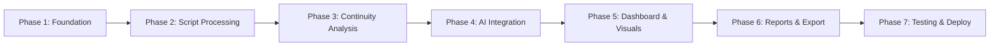

# PlotHole OS – Feature-by-Feature Implementation Roadmap

## Overview & Development Philosophy

PlotHole OS is structured into seven distinct developmental phases. This roadmap documents the baseline features already completed, enhancements delivered during recent audits, and forward-looking capabilities planned for upcoming releases.

---

## Phase 1 – Project Foundation

### Objectives
Establish a modular, type-safe architecture with centralized configuration, robust database persistence, and universal data model interoperability.

### Work Breakdown & Status
- [x] **Project Directory Structure**: Clean separation of `ai/`, `config/`, `core/`, `database/`, `detection/`, `reports/`, `sample_data/`, `tests/`, `utils/`, and `visualization/`. *(Completed)*
- [x] **Configuration Management (`config/settings.py`)**: Environment variables loaded via `python-dotenv` and Pydantic v2 `SettingsConfigDict` with sensible defaults. *(Completed)*
- [x] **Relational Persistence (`database/db.py`, `database/models.py`)**: SQLite with SQLAlchemy ORM, table schemas with foreign keys, and `expire_on_commit=False` configuration. *(Completed)*
- [x] **CRUD Operations Layer (`database/operations.py`)**: Clean functions for creating, reading, updating, and deleting projects, scenes, characters, events, objects, issues, and repair suggestions. *(Completed)*
- [x] **Universal Data Access Mixin (`ModelAccessMixin` & `SubscriptableSchema`)**: Implemented dual `.attribute` and `["key"]` access across all models to eliminate subscripting type errors. *(Completed)*
- [ ] **Database Migration System**: Implement Alembic for schema evolution and backward-compatible updates across releases. *(Planned)*

### Acceptance Criteria
- Database automatically initializes on startup without manual SQL scripts.
- No `DetachedInstanceError` or `TypeError: object is not subscriptable` when transferring records between database and UI.

---

## Phase 2 – Script Processing & Document Ingestion

### Objectives
Ingest screenplay and prose narrative documents in multiple formats, normalize encoding, and segment text into structured scenes with character dialogue and action blocks.

### Work Breakdown & Status
- [x] **Multi-Format Ingestion (`core/document_processor.py`)**: Support for PDF (`pypdf`), DOCX (`python-docx`), and plain text (`.txt`). *(Completed)*
- [x] **Validation & Integrity Guardrails**: File size checks (30MB ceiling), empty file detection, multi-encoding fallback (`utf-8`, `latin-1`, `cp1252`), and SHA-256 deduplication. *(Completed)*
- [x] **Screenplay Parsing Engine (`core/script_parser.py`)**: Regex-driven parser recognizing standard scene headings (`INT.`, `EXT.`), time cues (`DAY`, `NIGHT`), uppercase character names, parentheticals, and action lines. *(Completed)*
- [x] **Prose Story Support**: Fallback segmentation for narrative prose using chapter headings, divider lines, and adaptive paragraph chunking. *(Completed)*
- [x] **Consecutive Heading Collapsing**: Automatic collapse of split headings (e.g., `SCENE 1` followed on next line by `INT. LAB - DAY`) to prevent empty ghost scenes. *(Completed)*
- [x] **Character & Co-occurrence Extraction (`core/character_extractor.py`)**: Character profiling, appearance span, and co-occurrence matrix generation. *(Completed)*
- [x] **Chronological Event Extraction (`core/event_extractor.py`)**: Extract discrete events, participating characters, time cues, and sequence indices. *(Completed)*
- [ ] **Fountain Syntax Highlighting & Full Specification Support**: Native support for centered transitions (`> CUT TO: <`) and boneyard comments (`/* ... */`). *(Planned)*

### Acceptance Criteria
- Uploaded screenplays produce verified scene counts matching script sluglines.
- Prose stories without formal sluglines segment gracefully into readable narrative units.

---

## Phase 3 – Continuity & Logic Analysis Engine

### Objectives
Construct rule-based detectors capable of identifying 8 distinct classes of story inconsistencies with supporting evidence and scene citations.

### Work Breakdown & Status
- [x] **Timeline Contradiction Detector (`detection/timeline_detector.py`)**: Identifies backward clock jumps, impossible travel times, and chronologically inverted dependent events. *(Completed)*
- [x] **Character Consistency Detector (`detection/character_detector.py`)**: Discovers post-mortem appearances, speaking after death, and radical personality contradictions. *(Completed)*
- [x] **Location Continuity Detector (`detection/location_detector.py`)**: Detects character teleportation between distant locations in continuous time. *(Completed)*
- [x] **Character Knowledge Tracker & Leak Detector (`core/knowledge_tracker.py`, `detection/knowledge_detector.py`)**: Tracks secrets, passwords, and classified facts; flags characters who use or reference information prior to disclosure. *(Completed)*
- [x] **Object & Prop Continuity Detector (`core/object_tracker.py`, `detection/object_detector.py`)**: Monitors physical prop integrity and flags usage of destroyed, missing, or stolen objects. *(Completed)*
- [x] **Motivation Contradiction Detector (`detection/motivation_detector.py`)**: Discovers sudden unprompted alliance shifts and unmotivated betrayals. *(Completed)*
- [x] **Missing Narrative Transition Detector (`detection/missing_transition_detector.py`)**: Identifies abrupt, jarring location or narrative shifts missing connective context. *(Completed)*
- [x] **Logical Contradiction Detector (`detection/logical_detector.py`)**: Flags physical impossibilities, duplicate concurrent presences, and causal paradoxes. *(Completed)*
- [x] **Detector Coordinator (`detection/detector_coordinator.py`)**: Orchestrates parallel detection, deduplicates overlapping findings, and synthesizes confidence metrics. *(Completed)*

### Acceptance Criteria
- The built-in benchmark screenplay ("THE CIPHER PROTOCOL") detects all 8 planted continuity plot holes with verbatim supporting evidence.

---

## Phase 4 – Gemini AI Integration & Contextual Reasoning

### Objectives
Leverage Google Gemini API for deep contextual reasoning, character voice evaluation, and automated narrative repair proposal generation.

### Work Breakdown & Status
- [x] **Gemini Service Client (`ai/gemini_service.py`)**: Official `google-genai` SDK wrapper, structured JSON output validation, and temperature tuning. *(Completed)*
- [x] **Secure API Key Handling**: Reads from `.env` or Streamlit session state; never hardcoded; masked in UI. *(Completed)*
- [x] **Graceful Offline Fallback**: Application remains 100% operational in rule-based mode when no API key is provided. *(Completed)*
- [x] **Contextual Reasoning Engine (`ai/reasoning_engine.py`)**: Multi-scene context window evaluation for thematic tone and subtle motivation drift. *(Completed)*
- [x] **AI Story Repair Assistant (`ai/repair_assistant.py`)**: Generates primary and alternative narrative rewrites, downstream impact analysis, and line-by-line diffs. *(Completed)*
- [x] **Long-Script Chunking**: Sliding-window context chunker to analyze feature-length screenplays (120+ pages) without exceeding token limits. *(Completed)*
- [ ] **Custom Style Guidance Injection**: Allow screenwriters to provide custom prompt instructions (e.g. "Maintain Aaron Sorkin dialogue style"). *(Planned)*

### Acceptance Criteria
- Repair suggestions preserve the original scene's voice, formatting, and character motivations while resolving the continuity breach.
- App never crashes when an invalid API key or network disconnection occurs.

---

## Phase 5 – Dashboard & Interactive Visualizations

### Objectives
Provide an intuitive, dark-themed Streamlit user interface across 12 dedicated functional modules, featuring interactive Plotly and NetworkX visualizations.

### Work Breakdown & Status
- [x] **Professional Dark UI Theme (`app.py`)**: Custom CSS with `#0B0F17` canvas, slate cards, and color-coded severity borders. *(Completed)*
- [x] **12 Navigation Modules**:
  1. Overview & Health Score
  2. Upload Script & Preprocessing
  3. Scene-by-Scene Script Explorer
  4. Character Intelligence & Dossiers
  5. Story Timeline & Chronological Engine
  6. Spatial & Location Continuity Tracker
  7. Character Knowledge Tracker
  8. Continuity Breakdown & Plot Hole Registry
  9. AI Story Repair Workbench
  10. Reports & Export Dossier
  11. Project History Archive
  12. Settings & Environment Configuration *(Completed)*
- [x] **Visualization Suite (`visualization/`)**:
  - `create_timeline_chart`: Scene timeline with issue markers. *(Completed)*
  - `create_character_network_graph`: NetworkX spring-layout interaction graph. *(Completed)*
  - `create_character_appearance_chart`: Scene frequency vs dialogue count. *(Completed)*
  - `create_scene_distribution_chart`: Scene word count & character density. *(Completed)*
  - `create_severity_donut`: Breakdown of issues by severity. *(Completed)*
  - `create_issue_type_bar`: Category breakdown. *(Completed)*
  - `create_continuity_gauge`: Screenplay Logic Health Score (0–100). *(Completed)*
  - `create_location_journey_chart`: Spatial movement path across scenes. *(Completed)*
  - `create_knowledge_map`: Secret disclosures & witness coverage. *(Completed)*
- [x] **Defensive Chart Rendering**: All visualizers handle empty data, missing fields, or raw models without crashing. *(Completed)*

### Acceptance Criteria
- All 12 modules load cleanly without blank screens, missing components, or unhandled exceptions.

---

## Phase 6 – Reports & Export Engine

### Objectives
Produce production-ready downloadable deliverables summarizing continuity audits for producers, script supervisors, and screenwriters.

### Work Breakdown & Status
- [x] **Executive PDF Generator (`reports/pdf_generator.py`)**: Formal ReportLab document with metadata tables, continuity health metrics, character dossiers, scene breakdown, and evidence cards. *(Completed)*
- [x] **Structured JSON Exporter (`reports/json_exporter.py`)**: Full serialization of project scenes, characters, events, and detected issues for external data pipelines. *(Completed)*
- [x] **In-App Downloader**: One-click download buttons directly in the Streamlit UI. *(Completed)*
- [ ] **Final Draft (FDX) Export**: Export annotated screenplay with continuity notes directly into Final Draft XML format. *(Planned)*

### Acceptance Criteria
- Generated PDF opens cleanly in all standard PDF readers with proper margins, page wraps, and styling.
- JSON export strictly matches the application schema and contains no non-serializable objects.

---

## Phase 7 – Testing, Quality Assurance & Deployment

### Objectives
Establish comprehensive test coverage, continuous verification, and deployment readiness.

### Work Breakdown & Status
- [x] **Automated Pytest Suite (`tests/`)**: 16 comprehensive unit and regression tests covering parsing, database, detection, reporting, and visualization. *(Completed)*
- [x] **Subscripting Regression Tests (`tests/test_visualizations.py`)**: Explicit verification that all charts accept ORM objects, Pydantic schemas, and dicts without raising `TypeError`. *(Completed)*
- [x] **Bytecode Compilation Check**: Automated validation via `python -m compileall .`. *(Completed)*
- [x] **Sample Screenplay Benchmark (`sample_data/`)**: Verified detection of 8 deliberate continuity errors. *(Completed)*
- [ ] **Dockerization**: Create `Dockerfile` and `docker-compose.yml` for single-command containerized deployment. *(Planned)*

### Acceptance Criteria
- All automated tests pass with 100% success rate (`16 passed in ~3s`).
- `python -m compileall .` succeeds with zero errors.

