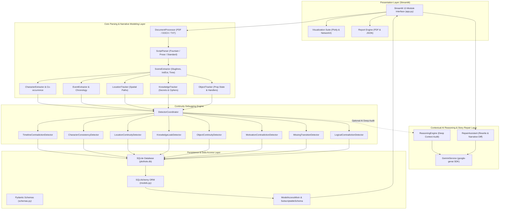
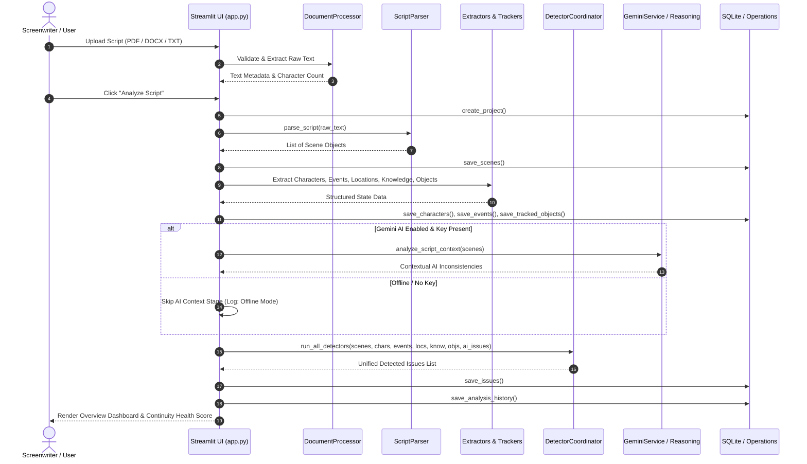

# PlotHole OS – System Architecture Specification

## 1. Executive Architectural Overview

**PlotHole OS** is an AI-powered narrative intelligence platform designed to ingest, parse, model, and debug written screenplays and narrative stories. Its architecture follows a **hybrid multi-tier pipeline**:

1. **Deterministic Rule-Based Detection Layer**: Uses regular expressions, named entity recognition (spaCy), syntactic analysis, and graph theory (NetworkX) to discover hard temporal, spatial, epistemic, and physical contradictions. Operates with 100% functionality offline without any API key.
2. **Contextual AI Reasoning & Repair Layer**: Uses Google Gemini models (`gemini-2.5-flash`, `gemini-2.5-pro`) to evaluate narrative motivation subtlety, character tone drift, and synthesize scene rewrites with line-by-line diffs.
3. **Reactive Presentation Layer**: Built on Streamlit with custom CSS and Plotly dark-themed interactive visualizations.

---

## 2. Multi-Tier Component Breakdown

### Tier 1: Ingestion & Document Preprocessing
- **`DocumentProcessor` ([core/document_processor.py](file:///c:/Users/moolc/OneDrive/Desktop/Generative%20ID/core/document_processor.py))**:
  - Validates upload MIME types and file extensions (`.pdf`, `.docx`, `.txt`).
  - Implements size caps (max 30MB) and empty-file rejection.
  - Multi-encoding fallback decoder (`utf-8`, `utf-8-sig`, `latin-1`, `cp1252`).
  - Text normalization: cleans erratic page breaks, carriage returns (`\r\n` -> `\n`), header noise, and computes SHA-256 content hashes to detect duplicate uploads.

### Tier 2: Structural Screenplay Parsing
- **`ScriptParser` ([core/script_parser.py](file:///c:/Users/moolc/OneDrive/Desktop/Generative%20ID/core/script_parser.py))**:
  - Dual-mode segmentation:
    - **Screenplay Mode**: Detects standard sluglines (`INT.`, `EXT.`, `INT/EXT.`, `I/E.`, `SCENE [0-9]+`), collapses split headings within 3 lines, extracts character dialogue cues in ALL CAPS, and isolates action blocks.
    - **Prose Mode**: When formal screenplay headings are absent, automatically partitions text by chapter headers, double-spaced section markers, or adaptive narrative paragraph chunks.
  - Generates typed `Scene` models with word counts, environment classifications, and character rosters.

### Tier 3: Narrative State Trackers
- **`TimelineEngine` & `EventExtractor` ([core/timeline_engine.py](file:///c:/Users/moolc/OneDrive/Desktop/Generative%20ID/core/timeline_engine.py), [core/event_extractor.py](file:///c:/Users/moolc/OneDrive/Desktop/Generative%20ID/core/event_extractor.py))**:
  - Parses explicit clock timestamps (e.g., `10:00 PM`, `22:15`, `03:45 AM`) and relative temporal indicators (`TWO HOURS LATER`, `THE NEXT MORNING`, `YEARS EARLIER`).
  - Sequences narrative events chronologically, identifying out-of-order anomalies.
- **`LocationTracker` ([core/location_tracker.py](file:///c:/Users/moolc/OneDrive/Desktop/Generative%20ID/core/location_tracker.py))**:
  - Maps unique environments and character spatial presence per scene.
  - Reconstructs character movement vectors across consecutive scenes.
- **`KnowledgeTracker` ([core/knowledge_tracker.py](file:///c:/Users/moolc/OneDrive/Desktop/Generative%20ID/core/knowledge_tracker.py))**:
  - Tracks confidential information, passcode disclosures, and secret facts.
  - Records the scene established, the discloser, and all witnesses present.
- **`ObjectTracker` ([core/object_tracker.py](file:///c:/Users/moolc/OneDrive/Desktop/Generative%20ID/core/object_tracker.py))**:
  - Tracks physical items, weapons, keys, and devices across handlers, recording status changes (`Intact`, `Destroyed`, `Stolen`).

### Tier 4: Continuity Debugging & Issue Detection
- **`DetectorCoordinator` ([detection/detector_coordinator.py](file:///c:/Users/moolc/OneDrive/Desktop/Generative%20ID/detection/detector_coordinator.py))**:
  - Orchestrates all 8 specialized detectors in parallel:
    1. **Timeline**: Conflicting clocks, impossible speeds, backward time jumps.
    2. **Character**: Speaking after death, erratic trait shifts.
    3. **Location**: Teleportation across distant locations within continuous time.
    4. **Knowledge**: Characters acting on confidential ciphers/facts prior to disclosure.
    5. **Object**: Using destroyed props, duplicate possession anomalies.
    6. **Motivation**: Abrupt character betrayals without causal triggers.
    7. **Transition**: Abrupt scene jumps missing narrative continuity cues.
    8. **Logical**: Impossible multi-location co-presence and post-mortem actions.
  - Merges rule-based detections with optional Gemini contextual inferences, deduplicating findings based on scene overlap and issue type.

### Tier 5: AI Contextual Reasoning & Repair
- **`GeminiService` ([ai/gemini_service.py](file:///c:/Users/moolc/OneDrive/Desktop/Generative%20ID/ai/gemini_service.py))**:
  - Official `google-genai` SDK wrapper with automatic JSON schema enforcement.
  - API key detection from `.env` or session state; safe offline degradation when missing.
  - Long screenplay chunking with sliding context windows.
- **`ReasoningEngine` ([ai/reasoning_engine.py](file:///c:/Users/moolc/OneDrive/Desktop/Generative%20ID/ai/reasoning_engine.py))**:
  - Subtlety auditor analyzing subtext, thematic tone, and emotional trajectories.
- **`RepairAssistant` ([ai/repair_assistant.py](file:///c:/Users/moolc/OneDrive/Desktop/Generative%20ID/ai/repair_assistant.py))**:
  - Formulates primary and alternative rewrite strategies.
  - Produces character-accurate revised scene dialogue/action.
  - Generates line-by-line narrative diffs (`added`, `deleted`, `equal`).

### Tier 6: Persistence & Data Access
- **SQLite Engine (`database/db.py`)**: Local storage in `plothole.db` with WAL mode and `expire_on_commit=False`.
- **`ModelAccessMixin` ([database/models.py](file:///c:/Users/moolc/OneDrive/Desktop/Generative%20ID/database/models.py))**: Provides `__getitem__` and `.get()` on all ORM models.
- **`SubscriptableSchema` ([core/schemas.py](file:///c:/Users/moolc/OneDrive/Desktop/Generative%20ID/core/schemas.py))**: Pydantic v2 schemas supporting dictionary syntax.

### Tier 7: Presentation, Analytics & Export
- **Streamlit Frontend (`app.py`)**: 12 dedicated navigation modules.
- **Visualizations (`visualization/`)**: 7 Plotly/NetworkX charts.
- **Report Generators (`reports/`)**:
  - ReportLab PDF builder with tables, callout cards, and confidence scores.
  - JSON exporter for integration with external production pipelines.

---

## 3. End-to-End Processing Sequence

---

## 4. Architectural Safeguards & Reliability Contracts

1. **Zero Silent Failures**: Every file validation failure, decoding error, or API disruption displays user-facing error cards with diagnostic reasons.
2. **Offline Resilience**: The rule-based detection engine, SQLite database, NetworkX graphs, and ReportLab PDF generators run completely offline without external internet or API access.
3. **Data Loss Prevention**: Screenplay uploads never overwrite or delete previous analyses unless explicitly triggered by the user via "Delete Project".
4. **Idempotent Ingestion**: SHA-256 script hashing prevents accidental duplicate ingestion passes on the same file.
5. **Universal Subscripting Contract**: Every boundary between ORM models, Pydantic schemas, and UI components uses `get_val()` to guarantee immunity to `TypeError: object is not subscriptable`.

